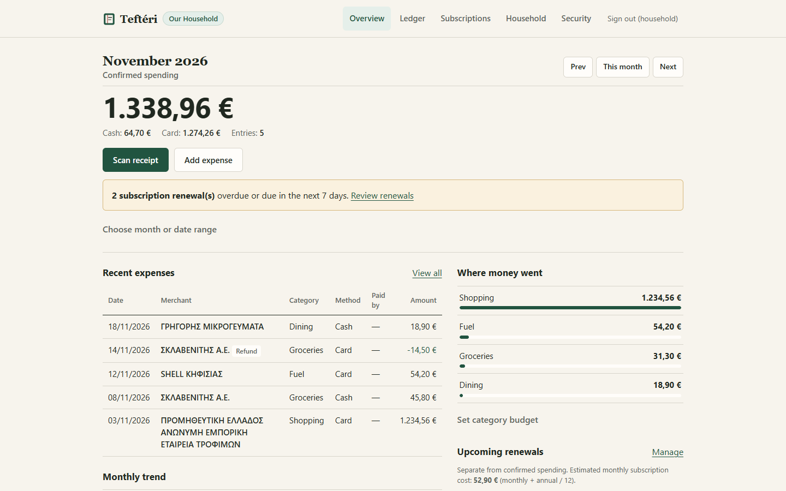
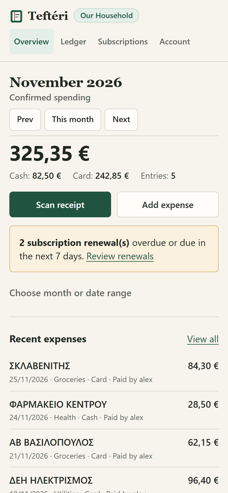
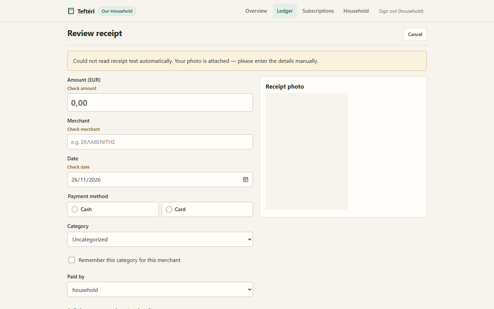
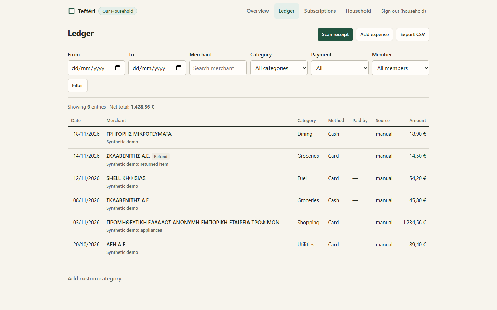

# Teftéri

[](https://github.com/zachanast18/tefteri)

Self-hosted household spending ledger (`tefteri`) built with Go, SQLite, embedded HTML/CSS/JS, and local Tesseract OCR (`ell+eng`). Runs anywhere Docker runs — home server, mini PC, NAS, VPS, Proxmox VM, or your laptop — with zero cloud OCR, hosted AI, telemetry, or external CDNs.

> From the Greek **τεφτέρι** (*teftéri*): the neighborhood shopkeeper's paper ledger book, now in a single Docker container.

## Features

- **Phone-first receipt capture:** Photograph a receipt, review extracted merchant, date, and final total (Greek + English via local Tesseract), choose Cash or Card, and save in under a minute.
- **Receipt review inbox:** Save incomplete, uncertain, or possible-duplicate drafts to **Needs review** without affecting confirmed spending until someone finishes them.
- **Multi-household & members:** Create separate households (e.g. home, vacation house), invite members with one-time codes, and switch active households from the header.
- **Who paid & optional splits:** Track **Paid by** and **Added by** separately, optionally split expenses equally or with custom amounts, view running member balances, and record settlements without altering household spending totals.
- **Category budgets & refunds:** Set optional monthly limits on the categories you care about, track remaining budget, and record refunds cleanly.
- **Subscriptions & renewal reminders:** Monthly and yearly subscriptions with month-end and leap-day recurrence anchors, 7/30-day in-app reminders, and idempotent confirmation.
- **UTF-8 CSV export & live SQLite backups:** Filter the ledger by date, merchant, category, payment method, or member, export to CSV, and take live backups with `VACUUM INTO`.

## Screenshots

| Overview (Desktop) | Overview (Mobile) |
| --- | --- |
|  |  |

| Receipt Review | Ledger |
| --- | --- |
|  |  |

## Quick Start (Docker Compose)

Works on any Linux, macOS, or Windows host with Docker and the Compose plugin:

1. Clone the repository and copy the example environment file:
   ```bash
   git clone https://github.com/zachanast18/tefteri.git
   cd tefteri
   cp .env.example .env
   chmod 600 .env
   ```

2. Generate the required 256-bit server wrapping key (`MASTER_KEY`) and set it in `.env` (keep a separate offline copy for restores):
   ```bash
   echo "MASTER_KEY=v1:$(openssl rand -base64 32)"
   ```
   Set the `MASTER_KEY=` line in `.env` to that `v1:...` output. (Alternatively, store it in a restricted file and mount it at `/run/secrets/tefteri_master_key` with `MASTER_KEY_FILE=/run/secrets/tefteri_master_key`.)

3. Build the image and run the first-time account setup (password is read without echoing; prints 8 single-use recovery codes to save offline):
   ```bash
   docker compose build
   docker compose run --rm app setup-account
   ```

4. Start the service in the background:
   ```bash
   docker compose up -d
   ```

5. Check health and open the app:
   ```bash
   docker compose ps
   ```
   Open `http://127.0.0.1:8080` (or your HTTPS reverse proxy URL on your phone), then open the **Household** tab to add your partner, create additional households, or generate invite codes.

## Defaults & Configuration

Defaults are `EUR` (`€`), `Europe/Athens`, `ell+eng` OCR languages, and `127.0.0.1:8080`. Edit `.env` before starting to customize:

| Variable | Default | Description |
| --- | --- | --- |
| `BIND_ADDR` | `127.0.0.1` | Host IP to bind. Keep `127.0.0.1` when a reverse proxy runs on the same host, or set your server's private LAN/VPN IP if the proxy runs elsewhere. |
| `APP_PORT` | `8080` | Host port mapped to container port `8080`. |
| `APP_CURRENCY` | `EUR` | ISO currency code displayed in forms and CSV exports. |
| `APP_CURRENCY_SYMBOL` | `€` | Currency symbol used in formatted totals. |
| `APP_TIMEZONE` | `Europe/Athens` | IANA timezone for calendar dates and subscription schedules. |
| `OCR_LANGUAGES` | `ell+eng` | Tesseract language packs passed to `-l` (bundled in the image). |
| `OCR_TIMEOUT_SECONDS` | `25` | Subprocess timeout for a single receipt scan. |
| `COOKIE_SECURE` | `auto` | `auto` sets the `Secure` cookie flag when `X-Forwarded-Proto: https` or TLS is present. |

## Phone Access via HTTPS Reverse Proxy

Phone browsers work best with HTTPS for camera access and secure cookies. Keep `BIND_ADDR=127.0.0.1` if Caddy, Nginx, or Traefik runs on the same host, or set `BIND_ADDR=<PRIVATE_IP>` if the proxy runs on another machine.

Example Caddyfile:
```caddy
tefteri.home.arpa {
    reverse_proxy 127.0.0.1:8080
}
```

Ensure your proxy forwards `X-Forwarded-Proto: https` so `COOKIE_SECURE=auto` issues `Secure` session cookies.

## Operations

- **View logs:**
  ```bash
  docker compose logs -f app
  ```
- **Stop:**
  ```bash
  docker compose down
  ```
- **Update:**
  ```bash
  git pull
  docker compose up -d --build
  ```

## Live Backup and Restore

SQLite live backups use `VACUUM INTO` so both transactions and stored receipt images are captured consistently while the app is running.

### Export a backup outside the Docker volume

```bash
docker compose exec app /usr/local/bin/ledger backup /data/backup.db
docker compose cp app:/data/backup.db ./tefteri-backup-$(date +%F).db
docker compose exec app rm -f /data/backup.db
```

### Restore into a separate volume

```bash
docker volume create ledger_data_restore
docker run --rm -v ledger_data_restore:/data -v "$PWD":/backup debian:bookworm-slim \
  sh -c "cp /backup/tefteri-backup-YYYY-MM-DD.db /data/ledger.db && chown 10001:10001 /data/ledger.db"
```

## Star History

If Teftéri helped your household keep track of where the grocery money went, feel free to leave a star — it keeps the ink flowing in the ledger!

[](https://www.star-history.com/#zachanast18/tefteri&Date)
